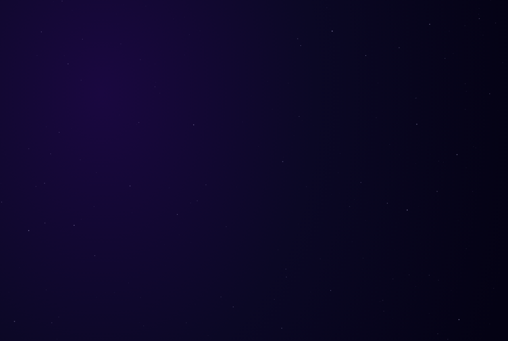
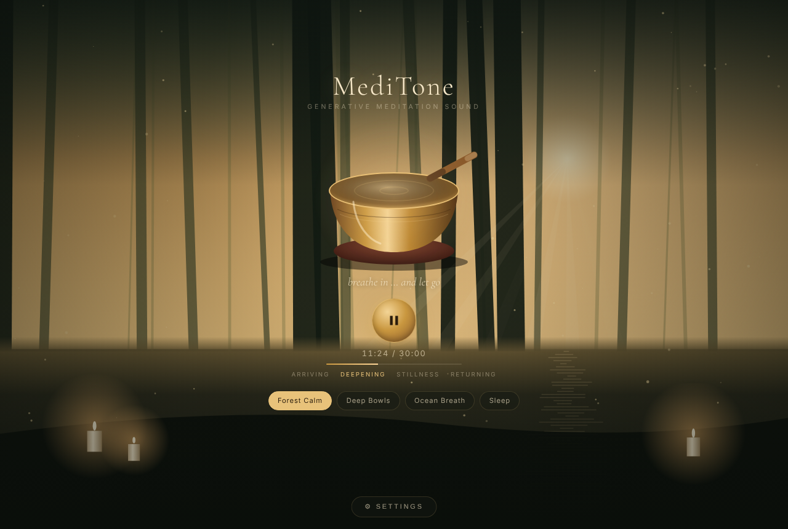
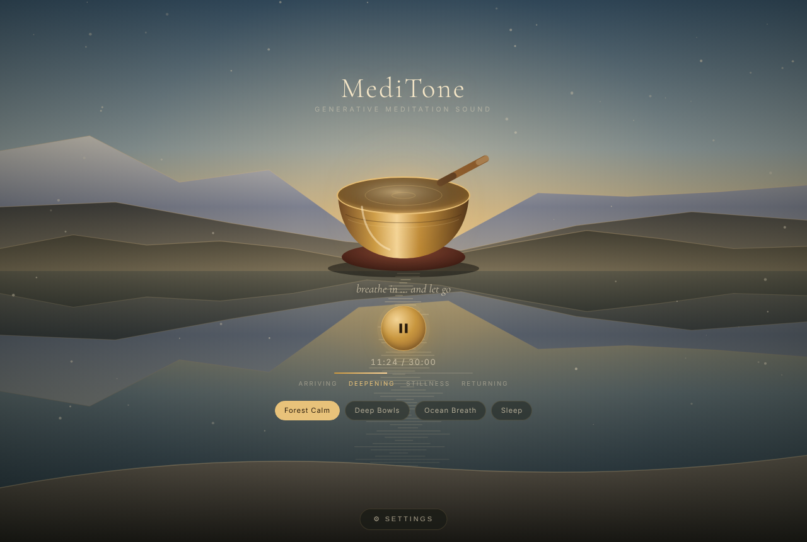
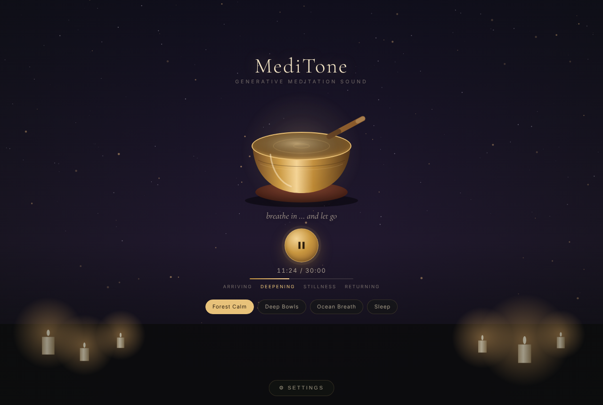
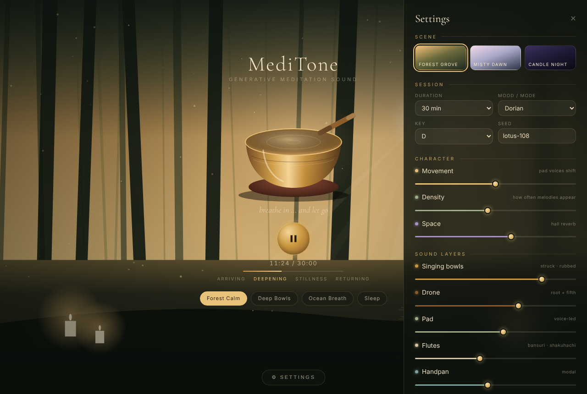
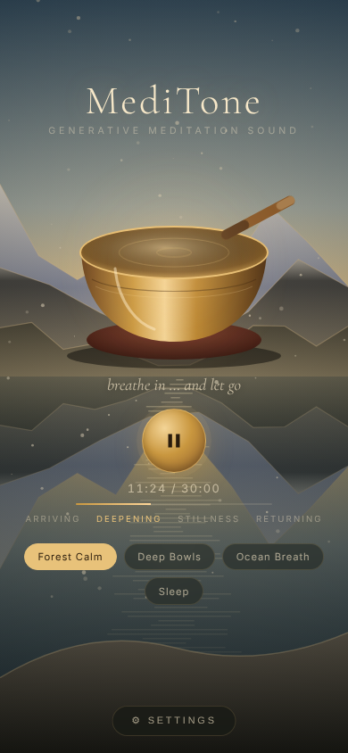

# MediTone — Design Concept "Singing Bowl & Calm Places"

Status: implemented in `index.html`. Decisions: default scene = mountain lake, presets = yes, light follows the session arc, binaural layer stays visible. Mockup: [`design-mockup.html`](design-mockup.html) (open in a browser, `?scene=grove|lake|night`).

## 1. Goal

Change the visual identity from "cosmic purple orb" to **a singing bowl in a calm natural place**.
The user must feel the sound before it starts: warm light, still water, brass, stone.

| Current | Proposed |
|---|---|
|  |  |

## 2. Design principles

1. **One object in the centre.** The singing bowl is the hero. It replaces the orb.
2. **Calm first, controls second.** The main screen shows only bowl, play, time and session phase. All settings move into a side drawer.
3. **Warm light, natural materials.** Brass, wood, stone, water, candle light. No neon.
4. **Slow motion only.** All animation is slower than a breath (≥ 6 s cycles). No hard cuts.
5. **Generated, not photographed.** Scenes are drawn procedurally on canvas. No stock photos, no licence issues, small file size, matches the "no samples" idea of the audio engine.

## 3. Scenes

The user selects a scene in the settings. Each scene has the same layout and the same bowl.

| Scene | Mood | Key elements | Screenshot |
|---|---|---|---|
| **Forest grove** (default) | Golden hour, sheltered | Tree silhouettes in 3 depth layers, sun rays, stream with light shimmer, candles, floating dust motes |  |
| **Mountain lake** | Sunrise, wide, clear | Snow peaks with rim light, sun in the valley behind the bowl, mirror reflection on the lake, stone ledge |  |
| **Candle night** | Evening, intimate, for sleep | Night sky with stars, rows of candles, warm sparks |  |

Possible later: scene follows the session arc (e.g. lake: dawn light rises during *Arriving*, is brightest in *Stillness*, fades in *Returning*), or follows the local time of day.

## 4. Layout

```
┌──────────────────────────────────────────┐
│               MediTone                   │  brand (serif, candle colour)
│                                          │
│            ◯  singing bowl  ◯            │  hero, ripples react to audio
│        "breathe in … and let go"         │  breathing cue, 9 s cycle
│                                          │
│                 ( ❚❚ )                   │  brass play button
│              11:24 / 30:00               │
│              ━━━━━──────────             │  session progress
│  ARRIVING · DEEPENING · STILLNESS · …    │  current phase highlighted
│                                          │
│  [Forest Calm] [Deep Bowls] [Ocean] …    │  quick presets (chips)
│                                          │
│               ⚙ Settings                 │  opens drawer
└──────────────────────────────────────────┘
```

**Settings drawer** (right side on desktop, full screen on mobile): Scene · Session · Character · Sound layers · Export.
All existing controls stay; only their place changes.



**Mobile:** same column; chips and phase labels wrap. 

## 5. The singing bowl (hero)

- SVG bowl: brass gradient body, engraved band, specular highlight, red cushion, wooden mallet.
- **Water surface inside the bowl** shows concentric ripples (cymatics idea).
  - Idle: very slow, faint ripples.
  - Playing: ripple amplitude and rate follow the audio RMS from the existing analyser. A struck bowl (`bowl` layer event) sends one strong ring.
- **Breathing guide** (implemented): the cue text shows *breathe in / hold / breathe out*; halo and bowl grow while breathing in and sink while breathing out; a thin ring around the bowl fills during each step. Patterns: Calm 4–6 (default), 4–7–8, Box 4–4–4–4, Off. Optional quiet bowl chime at each in/out change (pitched to the session key). With the guide off, the halo breathes freely with a 9 s cycle.
- Optional: tap on the bowl = play/pause (larger touch target than the button).

## 6. Colour palette

| Token | Hex | Use |
|---|---|---|
| `--forest-deep` | `#0f1712` | page background, deepest shadow |
| `--forest` | `#1d2a20` | panels |
| `--moss` | `#4f6140` | secondary surfaces |
| `--sage` | `#9fae8a` | Density, Pad |
| `--brass` | `#c9973f` | primary accent, play button, slider thumbs |
| `--brass-light` | `#e8c27a` | active state, headings in drawer |
| `--bronze` | `#8a5a2b` | Drone, mallet, depth |
| `--candle` | `#f6e7c8` | primary text |
| `--sunlight` | `#ffd79a` | glow, progress end |
| `--lavender` | `#a990c9` | Space, Binaural (link to the lavender in the reference image) |
| `--stone` | `#8d8a7f` | neutral details |

Text on scene: candle colour with soft dark text shadow + scene vignette, so contrast stays ≥ 4.5:1 for body text (to be verified per scene with a contrast check).

## 7. Typography

- **Headings / brand / breathing cue:** Cormorant Garamond (light, italic for the cue).
- **UI text:** Inter 300–500 (as today).
- Labels: uppercase, wide letter spacing, small size — as today, but in candle/brass colours.

## 8. Controls

- **Play button:** brass disc with soft outer ring. Pause icon in dark bronze.
- **Sliders:** thin track, brass thumb, colour per layer from the palette.
- **Presets (new):** chips that set mode, key, character and layer levels in one step, e.g.
  - *Forest Calm* — Dorian, flutes + pad, water low
  - *Deep Bowls* — bowls high, drone, few melodies
  - *Ocean Breath* — ocean high, slow movement
  - *Sleep* — 45 min, Aeolian, low density, candle night scene
- Rename layer "Ocean" to "Water" so it fits all scenes (sound can stay the same).

## 9. Motion rules

| Element | Cycle | Driver |
|---|---|---|
| Halo, breathing cue | 9 s | CSS keyframes |
| Bowl ripples | 2–6 s | audio RMS + bowl strikes |
| Light rays, water shimmer | 20–60 s drift | canvas |
| Dust motes / sparks | slow upward drift | canvas |
| Candle flicker | 7–13 Hz mix, small amplitude | canvas |

`prefers-reduced-motion`: stop rays, motes and ripples; keep a static scene and a slow opacity breath only.

## 10. Technical notes

- Keep `engine.js` unchanged. Only `index.html` changes.
- Replace the star canvas with a scene renderer (`grove`, `lake`, `night`), one function per scene.
- Replace orb canvas with SVG bowl + canvas ripples inside the bowl rim.
- Remove the Tailwind CDN dependency (small hand-written CSS with tokens is enough, see mockup).
- Pause canvas drawing when the tab is hidden (save battery).
- Store the selected scene in the existing `localStorage` settings.

## 11. Open questions

1. Default scene: forest grove or mountain lake?
2. Presets: yes / which ones?
3. Should the scene follow the session arc (light changes over time)?
4. Do we keep the binaural layer visible by default or move it to "advanced"?
5. App name stays "MediTone"?
